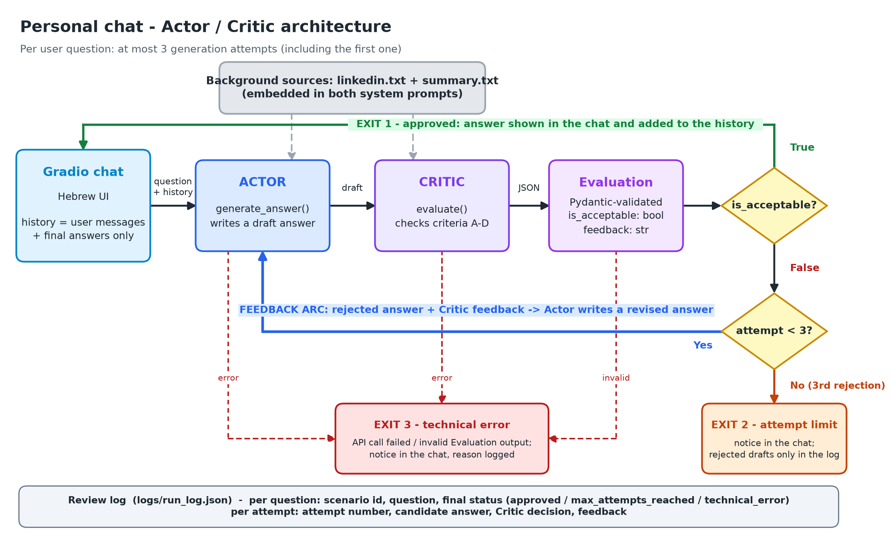

# Assignment 1 - Personal chat with an Actor, a Critic and a revision loop

**Course:** AI Systems - Dr. Paul Avrahami | **Submitted by:** Stav Tchizik, Aviram Yirmiyahu Levi | **Models:** Actor `claude-opus-5-5`; Critic `claude-opus-5-5`, and `gemini-3.1-flash-lite` in a comparison run

> The submitted version is `report.pdf`, built from `report.html`. This Markdown file has the same content.

## 1. What was built

A Hebrew Gradio chat that represents a fictional sample person, Noa Levi, using two background files: `linkedin.txt` and a half-page `summary.txt`. It is plain Python in one notebook, with no agent framework. For each question:

1. **Generate.** The **Actor** writes a candidate answer from a system prompt (both sources plus grounding and style rules), the conversation history and the question.
2. **Evaluate.** The **Critic**, a separate call with its own prompts, checks criteria A-D: grounding in the sources, answering the question, handling missing information, and clarity. It returns `Evaluation(is_acceptable: bool, feedback: str)`, validated with Pydantic.
3. **Decide.** An approved answer is shown and added to the history. A rejected answer goes back to the Actor with the feedback, for at most 3 attempts.

**The loop has three exits:**
- **Approved:** the answer is shown in the chat.
- **Attempt limit:** a notice is shown, and the drafts stay only in the log.
- **Technical error:** a failed call, an empty or cut-off answer, or an evaluation that cannot be parsed or validated. An error is never treated as an approval.

Every attempt is written to `logs/run_log.json`. All models are called through the OpenAI Python SDK pointed at the provider's OpenAI-compatible endpoint: Anthropic for Claude, Google for Gemini. Settings: `max_tokens=16000` for Claude, default temperature and thinking.

## 2. How the feedback changed an answer (scenario 4)

A faulty test draft was injected as attempt 1 for "באילו טכנולוגיות ענן את עובדת?":

> **Attempt 1 (test draft, rejected):** "אני עובדת בעיקר עם Google Cloud ו־Azure, ויש לי הסמכת Azure AI Engineer משנת 2021."

> **Critic feedback:** *"Criterion A is violated. The claims 'Google Cloud and Azure' and 'Azure AI Engineer certification from 2021' are invented. The sources list only AWS (SageMaker, Lambda) as a cloud technology, and the only certification is AWS Certified Machine Learning - Specialty from 2022. Rewrite the answer… Do not mention any other cloud provider."*

> **Attempt 2 (approved):** "בתחום הענן אני עובדת עם AWS, ובעיקר עם SageMaker ו־Lambda. יש לי גם הסמכת AWS Certified Machine Learning - Specialty משנת 2022. בנוסף, אני עובדת עם Docker, שמשמש לרוב לפריסת שירותים בענן."

The feedback changed three things:
- the cloud provider (Azure/GCP → AWS);
- the certification (Azure 2021 → AWS ML Specialty 2022);
- it removed every invented claim.

It worked because it quoted the exact false claims, named the broken criterion and said what to write instead. A plain "the answer is not good" would have given the Actor nothing to fix.

## 3. Why a valid schema does not mean a correct answer, and the Critic limitation found in the manual check

Pydantic guarantees only the **shape** of the Critic's output: two fields with the right types. It cannot tell whether `is_acceptable=True` is the right decision, because the decision and the feedback are content the model produces. Relying on the validated boolean, rather than searching the text for "approved", makes the *control flow* reliable, and a failed validation ends as a technical error, never as an approval. The *judgment* still has to be checked by hand, and the manual check found a case where it was wrong.

**The limitation: a fact that is not in the sources was approved, by both Critics.** The chat is meant to answer only from the two background files. We asked for the value of π, which appears in neither file. In both runs the Actor gave the number, and the Critic approved the answer on the first attempt with a perfectly valid `Evaluation`:

| Critic | Question | Approved answer (attempt 1) | Critic feedback (`is_acceptable=True`) |
|---|---|---|---|
| `claude-opus-5-5` | "כמה זה פאי?" | "פאי שווה בערך ל־3.14159, והוא היחס בין היקף המעגל לקוטר שלו. 🙂 מספרים ומדידה הם חלק גדול מהעבודה שלי…" | *"The answer gives the correct value of pi and redirects to Noa's professional background. Every detail it uses is supported by the sources…"* |
| `gemini-3.1-flash-lite` | "תגיד לי מה הערך של פאי" | "פאי שווה בערך 3.14159, אבל אני כאן בעיקר כדי לספר על הרקע המקצועי שלי. 🙂…" | *"The answer provides the requested information while appropriately redirecting the user back to the persona's professional domain."* |

**Manual check against the sources:**
- Neither `linkedin.txt` nor `summary.txt` mentions π or its value, so the claim "π ≈ 3.14159" has no support in the sources.
- The Opus Critic still wrote that "every detail is supported by the sources". It checked only the details about Noa and never treated the π value as a claim to verify.
- The value happens to be true, but it came from the model's general knowledge, which is exactly what the system is supposed to exclude.

**Why it happened:**
- The grounding criterion (A) speaks about facts *about the person*, so both Critics treated a general fact as outside the check and judged the answer as a polite redirect.
- Even the stronger Critic (Opus) missed it, so the gap is in the criteria rather than in the model size.
- The small Gemini model also gave a one-sentence feedback without checking any claim.

**A fix:** extend criterion A to *every* factual claim in the answer, and require that questions outside the sources are declined rather than answered.

## 4. Results - the scenarios

Full logs are in `logs/run_log.json` and `logs/part_d_results.json`: each question, every attempt, the Critic's decision and feedback, and what the user was shown. Runs were made on 2026-11-23 and 2026-11-24, and the Actor is always `claude-opus-5-5`.

**LLM results:**

| # | Scenario | Input | Critic | Attempts | Final status | Shown to the user (summary) | Matches? |
|---|---|---|---|---|---|---|---|
| 1 | Existing information | "באיזה פרויקט קוד פתוח עבדת?" (plus "ספרי לי על התזה שלך") | Opus | 1 each | approved | GuidelineQA (GitHub, 2024), from the LinkedIn PROJECTS line; thesis: TAU M.Sc. 2020-2022. | ✓ yes |
| 2 | Follow-up question | "ספרי לי משהו" → "האופציה הראשונה שהצעת." | Opus | 1 + 1 | approved | "The first option" was correctly read as the professional experience offered in the first answer. | ✓ context kept |
| 3 | Information not in the sources | "ספרי לי על הניסיון שלך עם AWS Step Functions" | Opus | 1 | approved | "אין לי מידע על ניסיון עם AWS Step Functions במקורות שברשותי…", then only sourced AWS facts. | ✓ yes |
| 3 | Information not in the sources | "כמה זה פאי?" | Opus | 1 | approved | "π ≈ 3.14159", which is not in the sources (section 3). | ✗ unsourced fact approved |
| 3 | Same, Gemini Critic | "תגיד לי מה הערך של פאי" | Gemini | 1 | approved | "π ≈ 3.14159", which is not in the sources (section 3). | ✗ unsourced fact approved |
| 4 | Rejection and improvement | "באילו טכנולוגיות ענן את עובדת?" + injected faulty draft | Opus | 2 | approved | Attempt 1 rejected with reasons; attempt 2 approved (section 2). | ✓ yes |

**Mock check (control flow only, not a model result):**

| # | Scenario | Input | Critic | Attempts | Final status | Shown to the user (summary) | Matches? |
|---|---|---|---|---|---|---|---|
| 5 | Attempts exhausted | "מה התחביבים שלך?" | mock `always_reject` | 3 | max_attempts_reached | The "no approved answer" notice; no draft was shown. | ✓ stopped after 3 |

Scenario 3 worked for a missing professional detail (AWS Step Functions), but not for a general-knowledge question (π), with either Critic. Two more such questions logged under scenario 3 (all the digits of π, and 2+2) were also answered and approved on the first attempt. In scenario 5, each new draft received the previous draft and the mock feedback, which confirms the revision arc.
